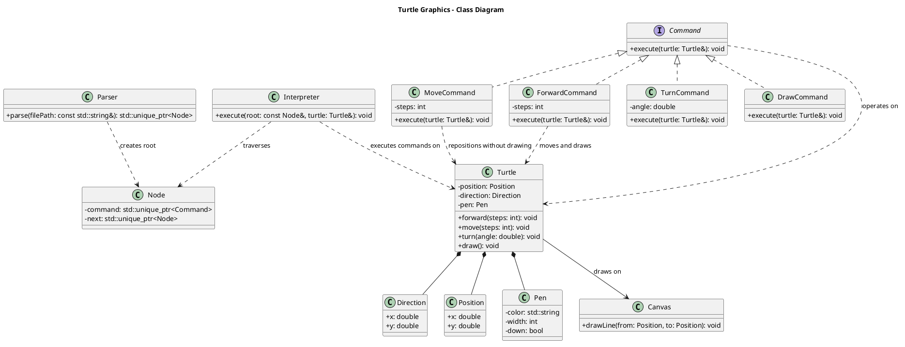

# Turtle Graphics

A turtle graphics language that allows users to create programs to move, turn,
and draw with a virtual turtle on a canvas. This project also explores SOLID
principles and Gang of Four design patterns.

## Build and test

GoogleTest is downloaded by CMake during configuration.

```sh
cmake -S . -B build
cmake --build build
ctest --test-dir build --output-on-failure
```

## Run the initial script

```sh
./scripts/run.sh
```

## Generate the class diagram

Install PlantUML and make its `plantuml` command available on `PATH`, then
configure the project and build the diagram target:

```sh
cmake -S . -B build
cmake --build build --target class_diagram
```

The SVG is generated at `build/diagrams/turtle.svg` from `turtle.puml`.
PlantUML is optional, so the C++ build and tests remain available without it.

Exploration of SOLID principles, and Design Pattenrs from Gang of Four. 

## Class Diagram 



##
Resources 
https://www.cs.wustl.edu/~taoju/research/TurtlesforCADRevised.pdf